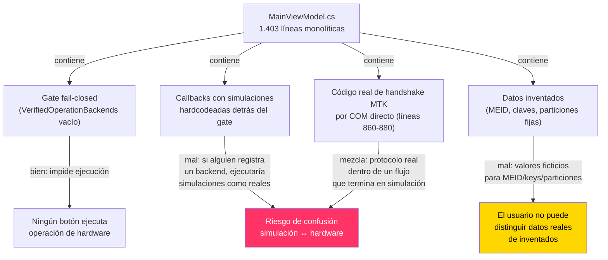
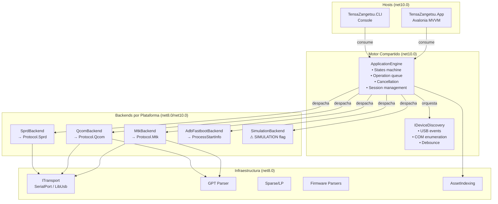
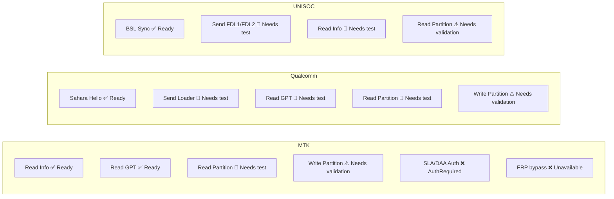
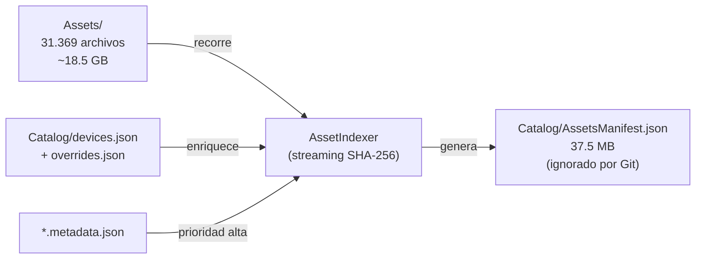
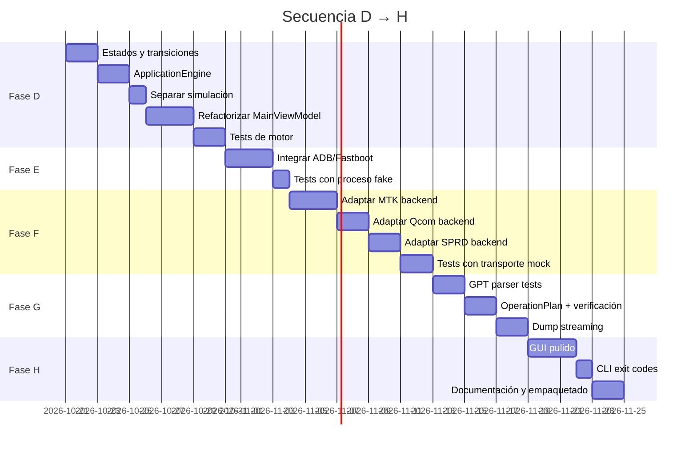

# Tensa-Zangetsu Pro Suite — Plan de Implementación por Fases

**Fecha:** 2026-10-20  
**Baseline:** Build Release 0 errores / 0 warnings · SDK .NET 10.0.402 · 33 proyectos · 31.369 assets indexados  
**Workspace:** [TensaZangetsu.slnx](file:///e:/rayitasgg/Documents/Tensa-Zangetsu-Portable/TensaZangetsu.slnx)

---

## 1. Diagnóstico del Estado Actual

### 1.1 Lo que ya existe y compila

| Capa | Proyectos | TFM | Estado real |
|------|-----------|-----|-------------|
| Protocolos MTK/Qcom/SPRD | 6 proyectos + 5 abstracciones | net8.0 | Código de protocolo real de GeekFlashCore; compila y tiene cobertura parcial en `.tests` (ignorados por Git) |
| Transportes | SerialPort, LibUsb, abstracciones | net8.0 | Implementaciones funcionales probadas en la CLI real |
| Sparse/GPT/BlockDevice/Firmware | 7 proyectos | net8.0 | Parsers funcionales (scatter, rawprogram, OFP, LP/super) |
| AssetIndexing | 1 proyecto + scratch/AssetIndexer | net8.0/net10.0 | 6 tests pasan; indexa 31.369 archivos con SHA-256 |
| Services | Engine, Catalog, Loaders, Firmware, ADB, Operations | net10.0 | **Problema principal**: `FlashEngineService` mezcla código real de handshake MTK (COM directo) con simulaciones hardcodeadas |
| App (GUI Avalonia) | 1 proyecto | net10.0 | 734 líneas de AXAML, 1.403 líneas de ViewModel monolítico; tiene gate fail-closed pero sus callbacks internos son simulaciones |
| CLI | 53 archivos | net10.0 | CLI funcional real con protocolo MTK/Qcom/SPRD, firehose, browser, storage, LP; **muy adelantada respecto a la GUI** |

### 1.2 Problemas Críticos Identificados



> [!CAUTION]
> El `MainViewModel` actual tiene **dos categorías de código que parecen funcionar pero no lo hacen**:
> 1. **Operaciones con callbacks simulados** (líneas 1016-1401): `ReadInfo`, `RemoveFrp`, `FactoryReset`, `UnlockBootloader`, `ReadHardwareKeys`, etc. Están protegidas por el gate vacío, pero sus bodies contienen `Task.Delay` + mensajes de "OK" que aparentarían éxito real si el gate se abriera.
> 2. **Valores inventados** (líneas 853-855, 1206-1217): HW codes, MEID, SoC names, particiones fijas que no provienen de un dispositivo.

> [!IMPORTANT]
> La **CLI** (`TensaZangetsu.CLI`) ya tiene implementaciones reales de protocolo: `MtkProtocolHostAdapter`, `QcomProtocolHostAdapter`, `SprdProtocolHostAdapter`, `FirehoseCommands`, `StorageCommands`, etc. El problema es que la **GUI no consume ese mismo motor** — reimplementa su propio flujo en el ViewModel.

---

## 2. Arquitectura Objetivo



### 2.1 Principios Arquitectónicos Inamovibles

| Regla | Implementación |
|-------|---------------|
| **Nunca bloquear UI thread** | `AsyncRelayCommand` + `Task.Run` para I/O; `Dispatcher.UIThread.Post` solo para actualizar bindings |
| **No asumir compilación limpia sin ejecutarla** | Cada fase ejecuta `dotnet build -c Release` y reporta salida real |
| **No copiar lista de modelos ≠ soporte** | Catálogo con estados explícitos: `ReferenceOnly`, `IndexedUnverified`, `ImplementedUntested`, `Verified`, `Unavailable` |
| **Simulación identificada** | Backend `SimulationBackend` con flag permanente `[SIMULATION]`; nunca comparte código con backends reales |
| **Motor compartido** | GUI y CLI consumen el mismo `ApplicationEngine`; no reimplementar flujos |

---

## 3. Fases de Implementación

### Fase D: Motor Compartido y Máquina de Estados

> [!NOTE]
> Esta es la fase inmediata. Las fases A–C ya están completadas parcialmente según [PROGRESS.md](file:///e:/rayitasgg/Documents/Tensa-Zangetsu-Portable/docs/PROGRESS.md).

**Objetivo**: Extraer un motor compartido que GUI y CLI consuman, con estados comprobables y simulación separada.

#### D.1 — Definir estados y transiciones en `Services`

```csharp
// src/TensaZangetsu.Services/Engine/OperationState.cs
public enum OperationState
{
    Idle,
    WaitingForDevice,
    CandidateDetected,
    AcquiringTransport,
    Handshaking,
    Identifying,
    ResolvingLoader,
    Authorizing,
    LoadingAgent,
    Ready,
    Planning,
    AwaitingConfirmation,
    Executing,
    Verifying,
    Completed,
    // Terminal/error states
    Cancelled,
    TimedOut,
    Disconnected,
    Unsupported,
    AuthRequired,
    RecoveryRequired,
    Failed
}
```

**Archivos a crear/modificar:**
- `src/TensaZangetsu.Services/Engine/OperationState.cs` — Estados
- `src/TensaZangetsu.Services/Engine/OperationStateMachine.cs` — Transiciones válidas y guards
- `src/TensaZangetsu.Services/Engine/ApplicationEngine.cs` — Orquestador compartido
- `src/TensaZangetsu.Services/Engine/IBackendProvider.cs` — Contrato de backend por plataforma

**Criterio de aceptación:**
- [ ] Tests de transiciones válidas e inválidas (sin hardware)
- [ ] Tests de cancelación durante cada estado
- [ ] Tests de reconexión tras desconexión
- [ ] Build Release 0 errores

#### D.2 — Separar simulación del hardware

**Qué hacer con el código actual:**

| Archivo | Código | Acción |
|---------|--------|--------|
| [MainViewModel.cs L789-1010](file:///e:/rayitasgg/Documents/Tensa-Zangetsu-Portable/src/TensaZangetsu.App/ViewModels/MainViewModel.cs#L789-L1010) | `ExecuteServicingOperationAsync` con simulación de phases 1-3 | Mover lógica de orquestación a `ApplicationEngine`; eliminar mensajes de "OK" simulados |
| [MainViewModel.cs L1016-1025](file:///e:/rayitasgg/Documents/Tensa-Zangetsu-Portable/src/TensaZangetsu.App/ViewModels/MainViewModel.cs#L1016-L1025) | `ReadInfoAsync` con particiones hardcodeadas | Reemplazar por llamada a `ApplicationEngine.ReadDeviceInfoAsync()` |
| [MainViewModel.cs L1027-1071](file:///e:/rayitasgg/Documents/Tensa-Zangetsu-Portable/src/TensaZangetsu.App/ViewModels/MainViewModel.cs#L1027-L1071) | `LoadSimulatedOrReadPartitions` con 19 particiones fijas | Mover a `SimulationBackend` con label `[SIMULATION]` |
| [MainViewModel.cs L1089-1401](file:///e:/rayitasgg/Documents/Tensa-Zangetsu-Portable/src/TensaZangetsu.App/ViewModels/MainViewModel.cs#L1089-L1401) | Todos los callbacks de operaciones (FRP, EFS, LK, etc.) | Reemplazar bodies por delegación al motor; si no hay backend → `Unavailable` |
| [MainViewModel.cs L853-855](file:///e:/rayitasgg/Documents/Tensa-Zangetsu-Portable/src/TensaZangetsu.App/ViewModels/MainViewModel.cs#L853-L855) | HW code, SoC name inventados | Eliminar; estos valores solo deben venir de hardware real o simulación etiquetada |

#### D.3 — Conectar GUI al motor compartido

Refactorizar `MainViewModel` de 1.403 líneas monolíticas a ViewModels por módulo:

```
ViewModels/
├── MainViewModel.cs          ← Navegación, estado global, log
├── ConnectionViewModel.cs    ← Puerto, device info, connect/disconnect
├── PartitionViewModel.cs     ← GPT, read/write/erase, firmware
├── ServiceViewModel.cs       ← Operaciones por plataforma
├── TestPointViewModel.cs     ← Visor de testpoints
└── SettingsViewModel.cs      ← Configuración del motor
```

**Criterio de aceptación:**
- [ ] GUI no bloquea el hilo UI en ninguna operación
- [ ] `[SIMULATION]` aparece permanentemente cuando se usa backend simulado
- [ ] Cambiar modelo invalida DA y planes anteriores
- [ ] Build Release 0 errores
- [ ] Tests de estados desde el ViewModel

---

### Fase E: Integración ADB/Fastboot de Solo Lectura

**Objetivo**: Primer backend real con herramientas configuradas por el usuario.

**Archivos:**
- `src/TensaZangetsu.Services/AdbFastboot/` — ya existe, verificar implementación
- Configuración de ruta a `adb`/`fastboot` en `Config/appsettings.example.json`

**Operaciones habilitables (solo lectura):**
| Operación | Comando | Estado esperado |
|-----------|---------|----------------|
| `device info` | `adb devices -l` / `fastboot getvar all` | Verified cuando se pruebe |
| `partition list` | `adb shell cat /proc/partitions` | ImplementedUntested |
| `bootloader status` | `fastboot getvar unlocked` | ImplementedUntested |

**Operaciones que permanecen Unavailable:**
- `fastboot oem edl` (escritura/cambio de modo)
- `fastboot flash` (escritura)
- `adb reboot edl` (cambio de modo con riesgo)

**Criterio de aceptación:**
- [ ] ProcessStartInfo con `ArgumentList` (sin shell)
- [ ] stdout/stderr consumidos concurrentemente
- [ ] Cancelación con `CancellationToken` y kill de proceso
- [ ] Tests con proceso fake que simula la salida de `adb`/`fastboot`
- [ ] Herramienta ausente → `Unavailable` con dependencia exacta

---

### Fase F: Adaptadores de Protocolos por Plataforma

**Objetivo**: Conectar los protocolos existentes (`Protocol.Mtk`, `Protocol.Qcom`, `Protocol.Sprd`) al motor compartido.

> [!WARNING]
> La CLI ya tiene adaptadores funcionales. El trabajo es **adaptar**, no reimplementar:
> - [MtkProtocolHostAdapter.cs](file:///e:/rayitasgg/Documents/Tensa-Zangetsu-Portable/src/TensaZangetsu.CLI/MtkProtocolHostAdapter.cs) (34.781 bytes)
> - [QcomProtocolHostAdapter.cs](file:///e:/rayitasgg/Documents/Tensa-Zangetsu-Portable/src/TensaZangetsu.CLI/QcomProtocolHostAdapter.cs) (6.323 bytes)
> - [SprdProtocolHostAdapter.cs](file:///e:/rayitasgg/Documents/Tensa-Zangetsu-Portable/src/TensaZangetsu.CLI/SprdProtocolHostAdapter.cs) (9.416 bytes)

**Plan:**
1. Extraer la lógica de conexión de los adaptadores CLI a `Services` como `IBackendProvider` implementations
2. Los adaptadores CLI y GUI consumen la misma implementación
3. Habilitar operaciones **una por una**, solo las que tengan pruebas

**Mapa de operaciones por plataforma:**



**Criterio de aceptación:**
- [ ] Backend `Unavailable` si la herramienta/protocolo no pasa la validación
- [ ] Sin bypass de autenticación
- [ ] Fixtures de protocolo y tests con transporte mock
- [ ] Cada operación habilitada tiene su test correspondiente

---

### Fase G: GPT Offline, Firmware y Planes

**Objetivo**: Activar parsers de GPT/firmware/plans con validación completa.

**Archivos existentes:**
- [TensaZangetsu.Gpt](file:///e:/rayitasgg/Documents/Tensa-Zangetsu-Portable/src/TensaZangetsu.Gpt) — Parser GPT
- [TensaZangetsu.Firmware](file:///e:/rayitasgg/Documents/Tensa-Zangetsu-Portable/src/TensaZangetsu.Firmware) — Parsers de firmware

**Tests requeridos:**
| # | Test | Descripción |
|---|------|-------------|
| 1 | GPT CRC inválido | Rechazar tabla con CRC corrupto |
| 2 | GPT solapamientos | Detectar particiones superpuestas |
| 3 | GPT overflow | Validar con ulong/checked, no truncar |
| 4 | GPT sector variable | No asumir 512 bytes |
| 5 | Plan hash changed | Rechazar plan si hash de entrada cambió |
| 6 | Plan identity changed | Rechazar si fingerprint del dispositivo cambió |
| 7 | Plan geometry changed | Rechazar si geometría de almacenamiento cambió |
| 8 | Dump .partial | Interrupción conserva .partial, no informa éxito |

---

### Fase H: Pulido GUI/CLI, Documentación y Empaquetado

**Objetivo**: GUI y CLI utilizables, documentadas, con capacidades honestas.

#### H.1 — GUI: Qué funciona vs. qué no

La GUI debe mostrar claramente el estado de cada función:

```
┌──────────────────────────────────────────────────────┐
│ CONNECT / READ INFO          [●] Operativo           │
│ Cargar firmware offline       [●] Operativo           │
│ Parsear scatter/rawprogram    [●] Operativo           │
│ Indexar assets                [●] Operativo           │
│ Visor testpoints              [●] Operativo           │
│ Buscar en catálogo            [●] Operativo           │
├──────────────────────────────────────────────────────┤
│ Read GPT (hardware)          [◐] Necesita backend    │
│ Read Partition (hardware)    [◐] Necesita backend    │
│ Reboot device                [◐] Necesita backend    │
├──────────────────────────────────────────────────────┤
│ Write Partition              [○] Necesita validación │
│ Erase Partition              [○] Necesita validación │
│ Flash Firmware               [○] Necesita validación │
│ Factory Reset                [○] Necesita validación │
├──────────────────────────────────────────────────────┤
│ Remove FRP                   [✕] No disponible       │
│ Remove Mi Account            [✕] No disponible       │
│ Remove Huawei ID             [✕] No disponible       │
│ Unlock Bootloader (seccfg)   [✕] No disponible       │
│ SLA/DAA Bypass               [✕] No disponible       │
│ Python Kamakiri              [✕] No disponible       │
│ RPMB Write/Erase             [✕] No disponible       │
│ LK Patch                     [✕] No disponible       │
│ OEMINFO Write/Erase          [✕] No disponible       │
└──────────────────────────────────────────────────────┘
```

#### H.2 — CLI: Comandos y exit codes

| Exit Code | Significado |
|-----------|-------------|
| 0 | Éxito |
| 1 | Error de argumentos |
| 2 | Timeout |
| 3 | Cancelación por usuario |
| 4 | Operación no soportada |
| 5 | Autenticación requerida |
| 6 | Fallo de operación |
| 7 | Recuperación necesaria |

---

## 4. Indexador: Especificación Operativa

El indexador ya existe y funciona. Esta sección documenta cómo debe usarse y qué garantiza.

### 4.1 Flujo de datos



### 4.2 Lo que el indexador NO hace

- No renombra, mueve ni ejecuta binarios
- No asume que `.bin` = DA ni que `.xml` = scatter V6
- No empareja loaders por proximidad de ruta
- No crea bundles sin metadatos explícitos
- No resuelve DTD ni entidades externas en XML
- No sigue symlinks por defecto

---

## 5. Pruebas: Mapa de Cobertura

### 5.1 Estado actual

| Área | Tests existentes | Ubicación | Estado |
|------|-----------------|-----------|--------|
| Asset Indexing | 6 tests | `.tests/TensaZangetsu.AssetIndexing.Tests` | ✅ Pasan |
| Protocolos | Tests en GeekFlashCore | Workspace separado | No aplican directamente |
| GUI | 0 | — | ❌ Pendiente |
| Motor | 0 | — | ❌ Pendiente (Fase D) |
| GPT | 0 en este workspace | — | ❌ Pendiente (Fase G) |
| CLI | 0 automatizados | — | ❌ Pendiente (Fase H) |

### 5.2 Tests requeridos por fase

Los 17 tests obligatorios del prompt §13 se mapean así:

| # | Test del prompt | Fase | Prioridad |
|---|----------------|------|-----------|
| 1 | Indexación con rutas especiales | C ✅ | Completado (6 tests) |
| 2 | XML malicioso rechazado | C/G | Alta |
| 3 | Manifiesto inválido no reemplaza | C ✅ | Completado |
| 4 | Metadatos contradictorios | C/D | Alta |
| 5 | Cambiar modelo invalida DA | D | Alta |
| 6 | Puerto aparece/desaparece durante handshake | D | Alta |
| 7 | Cancelación/timeout sin UI bloqueada | D | Crítica |
| 8 | Dispositivo distinto tras reconectar | D | Alta |
| 9 | CONNECT no invoca reboot/write/erase | D | Crítica |
| 10 | Backend ausente → Unavailable | D | Alta |
| 11 | GPT CRC, solapamientos, overflow | G | Alta |
| 12 | Plan de flash con hash cambiado se rechaza | G | Alta |
| 13 | Errores de proceso externo | E | Media |
| 14 | Dump interrumpido conserva .partial | G | Alta |
| 15 | Simulación separada de hardware | D | Crítica |
| 16 | CLI --json y exit codes | H | Media |
| 17 | Avalonia headless tests | H | Baja (depende de versión) |

---

## 6. Criterios de Entrega

### 6.1 Entrega Mínima Aceptable (Fase D completada)

- [ ] `dotnet build TensaZangetsu.slnx -c Release`: 0 errores, 0 warnings
- [ ] Motor compartido con estados comprobables
- [ ] GUI no bloquea UI thread en ninguna ruta
- [ ] Simulación etiquetada como `[SIMULATION]` permanente
- [ ] Operaciones sin backend devuelven `Unavailable` (no `Task.Delay` + "OK")
- [ ] Cambiar modelo invalida DA y planes
- [ ] Assets originales intactos (comparar SHA-256 con auditoría inicial)
- [ ] `docs/PROGRESS.md` actualizado con evidencia

### 6.2 Entrega Completa (Fase H completada)

- [ ] Todo lo anterior
- [ ] Backends por plataforma conectados al motor (solo operaciones verificadas)
- [ ] GPT parser con cobertura de tests offline
- [ ] CLI con exit codes documentados y `--json` limpio
- [ ] `docs/BUILD_REPORT.md` con comandos ejecutados y resultados reales
- [ ] `README.md` con instalación, configuración, capacidades honestas y limitaciones
- [ ] Ningún modelo declarado como `Verified` sin evidencia de hardware

### 6.3 Lo que NO es criterio de entrega

| No es entrega | Por qué |
|---------------|---------|
| "Compilar" los protocolos | Compilar ≠ protocolo correcto |
| Tener botones con nombres de operaciones | Botones ≠ funcionalidad |
| Lista de 1.000 modelos en el catálogo | Lista ≠ soporte |
| Mensajes de "OK" en la consola | Mensajes ≠ evidencia de operación |
| Gate cerrado sin reemplazar callbacks | El código detrás del gate sigue siendo simulación |

---

## 7. Secuencia de Trabajo Inmediata



> [!TIP]
> La **primera acción concreta** es crear `OperationState.cs` y `OperationStateMachine.cs` con tests, y luego crear `ApplicationEngine.cs` como el orquestador que tanto GUI como CLI consuman. Esto desbloquea todo lo demás.

---

## 8. Riesgos Abiertos

| Riesgo | Mitigación |
|--------|-----------|
| La solución mezcla net8.0 y net10.0 | Las bibliotecas son net8.0, compatible con net10.0; no migrar sin justificación |
| No hay hardware de laboratorio | Priorizar tests con transporte mock; declarar todo como `ImplementedUntested` hasta evidencia |
| UnlockTool HTTP 403 | No afirmar capacidades por modelo; usar solo ejemplos del usuario como `ReferenceOnly` |
| Assets de 18.5 GB | Indexador ya es streaming e incremental |
| Callbacks simulados detrás del gate | **Fase D los reemplaza por delegación al motor**; es el riesgo más urgente |
| CLI muy adelantada respecto a GUI | Extraer lógica compartida de CLI a Services; no duplicar |
